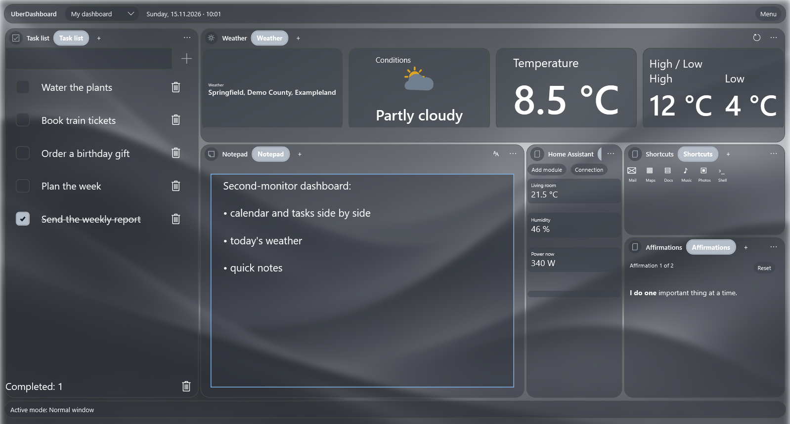
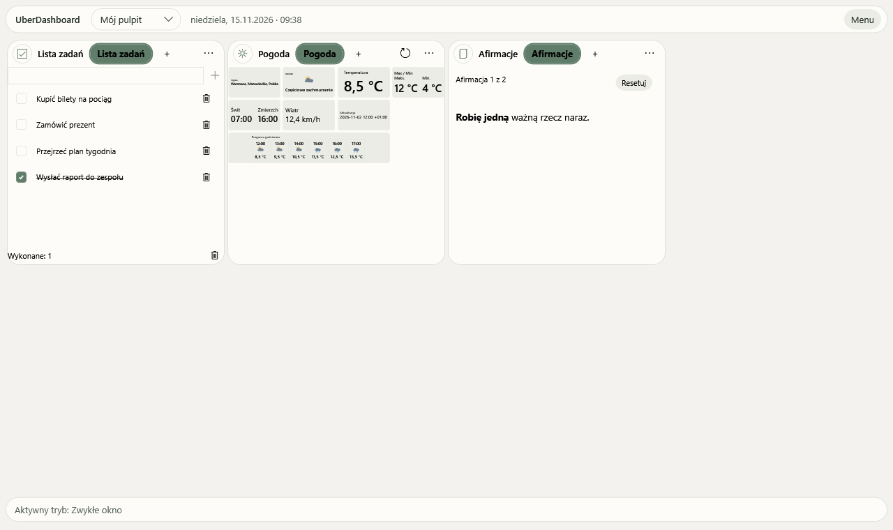
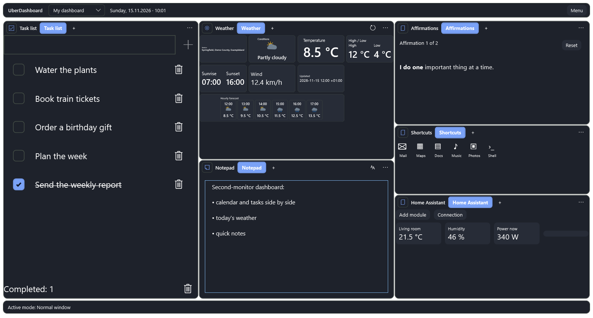
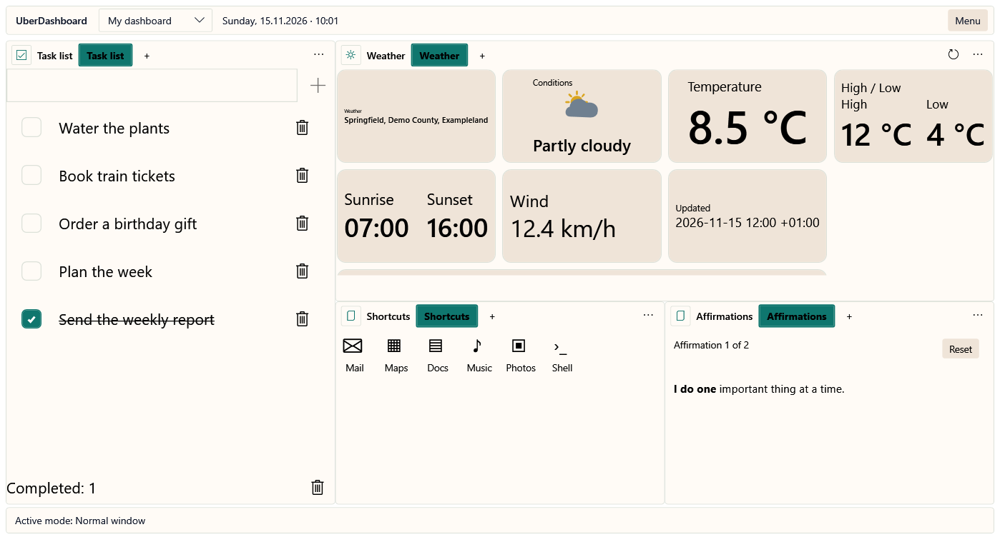

# UberDashboard

A personal desktop dashboard for Windows 11: notes, to-do lists, calendar, weather, shortcuts, a system monitor and more — side by side in one customizable window. Run it as a normal window or dock it as a bar to a screen edge. Your layout and content are stored locally.



## What you can do with it

- **Build your own layout** — add panels, resize, move, hide and restore them. Multiple dashboards and per-panel tabs are supported.
- **Notes** — rich-text notepad with TXT and Markdown import.
- **To-do lists** — local lists with TXT/Markdown/CSV import and optional sync with Microsoft To Do.
- **Calendar** — Google Calendar views: month, week, day, custom range and agenda.
- **Weather** — forecast for a chosen city from Open-Meteo, with several icon sets.
- **Shortcuts** — launch apps, folders, documents and web pages from icons, lists, buttons or tiles.
- **Home Assistant** — show sensor values and trigger actions on your local Home Assistant.
- **Resource monitor** — CPU, GPU, RAM and VRAM usage; temperatures and fans when sensors are available.
- **Affirmations** — practice your own texts and track progress.
- **Plugins** — extra panels shipped as `.udplugin` packages (for example a photo frame).
- **Personalization** — light, dark or system theme, accent and surface colors, 10 ready-made color themes, fonts, wallpapers, corner radius, spacing and per-panel appearance. The UI is available in English and Polish.

## Screenshots

| Light theme | Blue dark theme |
|---|---|
|  |  |

| Warm light theme |
|---|
|  |

All screenshots are generated from mock data: `dotnet run --project tests/UberDashboard.Screenshots -- docs/screenshots`.

## Install

Download the latest installer from the [Releases](https://github.com/Kavaars/UberDashboard/releases) page and run it. Windows 11 (x64) is the supported platform.

## Build from source

Requires Windows and the .NET SDK pinned in [`global.json`](global.json).

```bash
dotnet build UberDashboard.slnx
dotnet test UberDashboard.slnx
```

`budujdev.bat`, `budujfast.bat`, `budujprod.bat` and `budujinst.bat` wrap `scripts/BuildTools.ps1` (development, fast, production and installer builds). The installer build needs [Inno Setup 6](https://jrsoftware.org/isinfo.php).

## Integrations and privacy

Your data stays on your computer. The app contacts the network only for features you enable (weather, Microsoft To Do, Google Calendar, Home Assistant). Sign-in tokens are stored encrypted with Windows DPAPI. Google Calendar requires your own OAuth client file. See the [Privacy Policy](PRIVACY.md).

## Plugins

Panel plugins are described in [`docs/PLUGINS.md`](docs/PLUGINS.md), with a sample project in [`plugins/PanelTemplates`](plugins/PanelTemplates).

## Documentation

- [Plugins](docs/PLUGINS.md)
- [Microsoft To Do](docs/MICROSOFT_TODO.md)
- [Shortcuts panel](docs/PANEL_SHORTCUTS.md)
- [Calendar and resource monitor](docs/PANELS_CALENDAR_AND_RESOURCES.md)

Polish translations of the documentation are in [`docs/pl`](docs/pl).

## Feedback

Found a bug or have an idea? [Open an issue](https://github.com/Kavaars/UberDashboard/issues).

## License

UberDashboard is released under the [MIT License](LICENSE). Third-party components are listed in [THIRD-PARTY-NOTICES.md](THIRD-PARTY-NOTICES.md).
